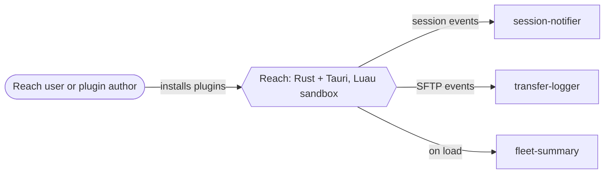

# reach-plugins

Three example Lua plugins for [Reach](https://github.com/alexandrosnt/Reach), the open-source SSH client built with Rust and Tauri. Two show in-app notifications when SSH sessions connect or disconnect and when SFTP transfers finish. The third lists your open sessions. They are small working examples for plugin authors to copy.

## How it works

Each plugin is a folder with a `plugin.toml` manifest and a `main.lua`. Reach runs `main.lua` in a sandboxed Luau VM and calls a Lua function when a listed event fires.

| Plugin | Behavior | Permissions |
|---|---|---|
| [`session-notifier`](plugins/session-notifier) | `Connected: <user>@<host>` and `Disconnected: <connection-id>` toasts | `notify` |
| [`transfer-logger`](plugins/transfer-logger) | `Upload complete` and `Download complete` toasts for finished SFTP transfers | `notify` |
| [`fleet-summary`](plugins/fleet-summary) | On load, lists open sessions as `user@host` | `ssh_list_connections`, `notify` |

Toasts show inside the Reach window, not as OS notifications, and only while the Plugins sidebar panel is open. On disconnect Reach sends only the connection ID, so the host name is not shown. `fleet-summary` runs once at load and does not track later sessions.

## Install

1. `git clone https://github.com/thefiredev-cloud/reach-plugins.git`
2. In Reach, open Settings > Plugins to find the plugins directory.
3. Copy a plugin folder in: `cp -r reach-plugins/plugins/session-notifier <plugins-dir>/`. The folder name must match `id` in `plugin.toml`.
4. Select Discover Plugins in Settings > Plugins, or restart Reach. Reach grants every permission the manifest lists with no prompt, so read it first.
5. Open the Plugins panel in the sidebar to see toasts.

Changing `version` in `plugin.toml` clears the stored permission grant. Toggle the plugin off and on to grant it again.

## Write your own

Copy a plugin folder, change `id` (and the folder name) and `name`, request only the permissions you use, and list each event in `hooks`. Hook names, `data` fields, host functions, permissions and sandbox limits are in [docs/PLUGIN-API.md](docs/PLUGIN-API.md).

To publish through a Reach registry, zip the plugin with `plugin.toml` at the root (`cd plugins/session-notifier && zip -r ../../session-notifier.zip .`). A registry entry needs a `downloadUrl` and the zip's SHA-256.

## Status and limits

- Version 1.0.0 examples. No tests or CI.
- Reach labels its plugin system beta, so the API can change. The API notes match Reach source at commit `5c2ab55`; Reach's published plugin docs describe an older API.
- No network access, no external Lua libraries, no stored settings.
- Not affiliated with the upstream Reach project.

## License

All rights reserved. See [LICENSE](LICENSE). Contact: [tanner@kodros.ai](mailto:tanner@kodros.ai).
