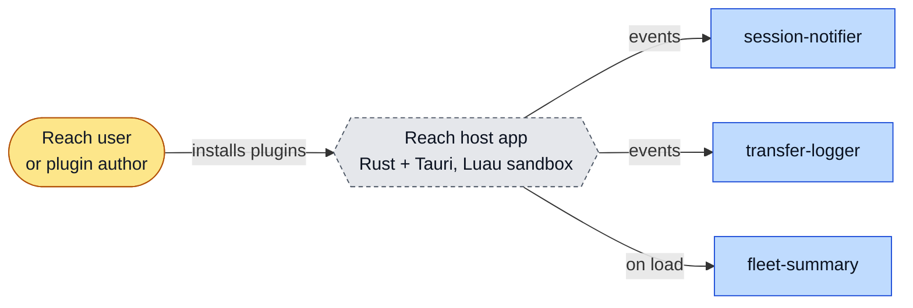
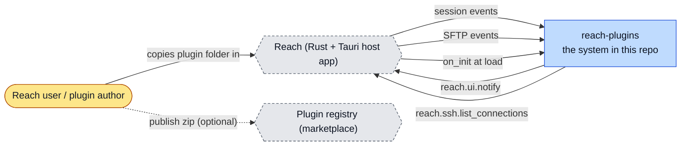
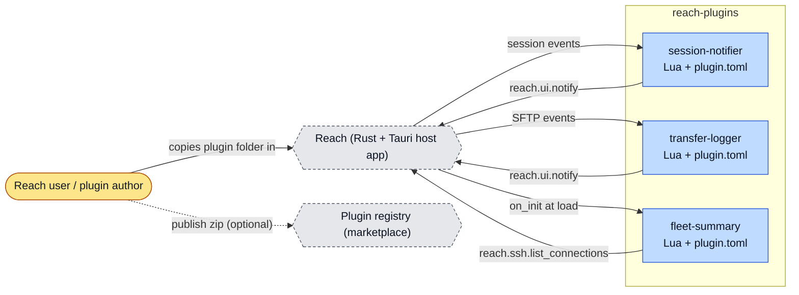
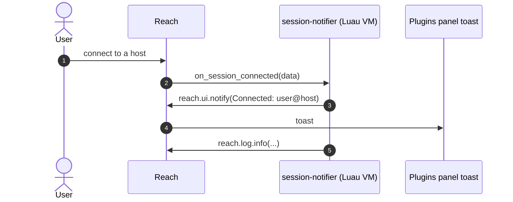
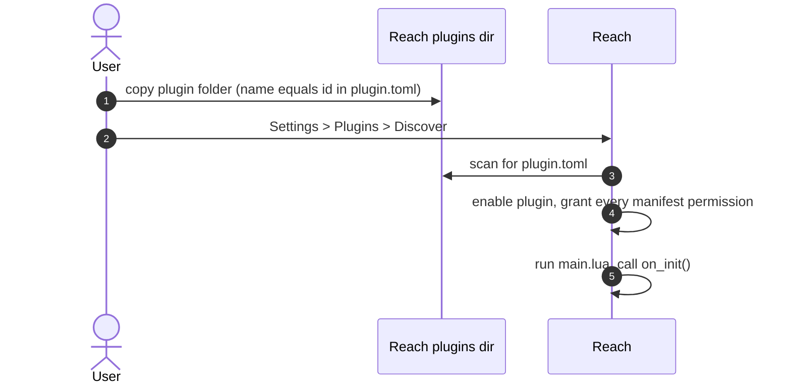
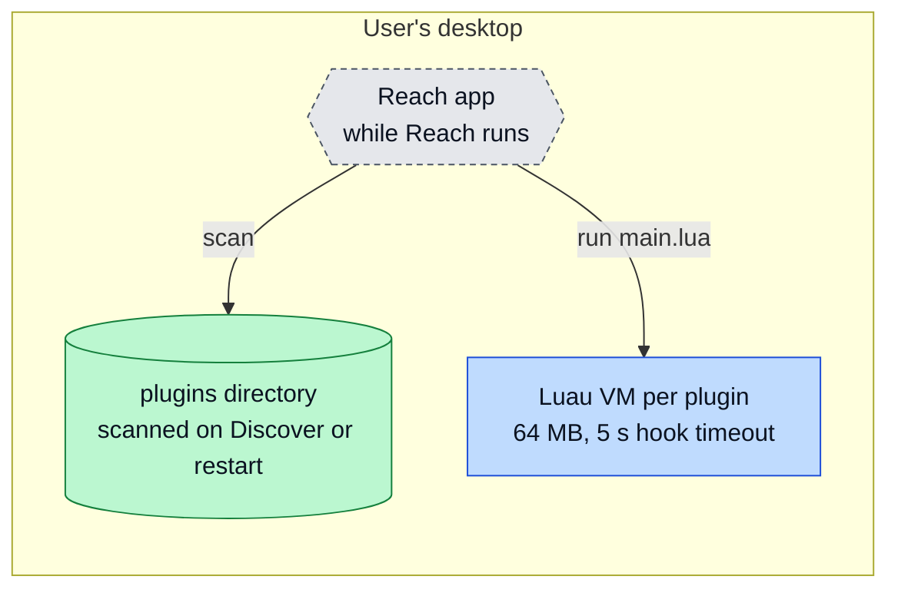

# reach-plugins: architecture

<!-- arch-kit:generated -->

> Whiteboard-level structure: what systems exist, what they talk to, and when they run. Evidence-backed; every box below maps to a path listed in [Evidence](#10-evidence).
> Generated by the ArchDocs kit from repo commit `6321899e90`. Diagram sources: [`architecture/*.mmd`](architecture/). Hi-res renders sit next to each source.

## 1. Purpose

reach-plugins holds three small Lua plugins for Reach, the open-source SSH client built with Rust and Tauri. Each plugin is a folder with a `plugin.toml` manifest and a `main.lua` entry file. Reach runs `main.lua` in a sandboxed Luau VM and calls a Lua function when a matching event fires. Two plugins show in-app toasts when SSH sessions or SFTP transfers finish; the third lists open sessions once, at load. There is no build, no test suite and no CI. The repo is a set of examples to copy.

## 2. Whiteboard view

Five boxes. The plugins never run on their own: Reach calls them when something happens.

Hi-res: [SVG](architecture/whiteboard.svg) · [PNG 3x](architecture/whiteboard@3x.png) · [dark SVG](architecture/whiteboard.dark.svg) · [dark PNG 3x](architecture/whiteboard.dark@3x.png)

Explorable version (Archify, standalone HTML, download and open locally): [`architecture/reach-plugins.archify.html`](architecture/reach-plugins.archify.html)

## 3. System context (C4 level 1)

Who and what touches the system from outside.

Hi-res: [SVG](architecture/context.svg) · [PNG 3x](architecture/context@3x.png)

## 4. Containers and components (C4 level 2)

The parts that run or hold data inside the repo's system boundary.

Hi-res: [SVG](architecture/containers.svg) · [PNG 3x](architecture/containers@3x.png)

| Container | Kind | Tech | What it does | Evidence |
|---|---|---|---|---|
| session-notifier | app | Lua + plugin.toml | Hooks session:connected and session:disconnected; shows a toast. | [`plugins/session-notifier/main.lua#L7-L18`](../plugins/session-notifier/main.lua#L7-L18), [`plugins/session-notifier/plugin.toml#L7-L8`](../plugins/session-notifier/plugin.toml#L7-L8) |
| transfer-logger | app | Lua + plugin.toml | Hooks sftp:upload_complete and sftp:download_complete; shows a toast. | [`plugins/transfer-logger/main.lua`](../plugins/transfer-logger/main.lua), [`plugins/transfer-logger/plugin.toml`](../plugins/transfer-logger/plugin.toml) |
| fleet-summary | app | Lua + plugin.toml | No hooks. on_init lists open sessions as user@host once at load. | [`plugins/fleet-summary/main.lua#L3-L15`](../plugins/fleet-summary/main.lua#L3-L15), [`plugins/fleet-summary/plugin.toml`](../plugins/fleet-summary/plugin.toml) |

## 5. Key runtime sequences

### 5.1 A session connects

Reach passes one table, `data`. The toast shows only while the Plugins sidebar panel is open.

Hi-res: [SVG](architecture/sequence-1.svg) · [PNG 3x](architecture/sequence-1@3x.png)

### 5.2 Installing a plugin

Hi-res: [SVG](architecture/sequence-2.svg) · [PNG 3x](architecture/sequence-2@3x.png)

## 6. Data flow and stores

No data store. The plugins keep no settings and store nothing; each call receives a `data` table from Reach and returns a message to the host.

## 7. Deployment and runtime topology

Plugins run inside the Reach desktop app on the user's machine. Nothing is hosted.

Hi-res: [SVG](architecture/deployment.svg) · [PNG 3x](architecture/deployment@3x.png)

| What | Where | Runs when | Trigger / port | Evidence |
|---|---|---|---|---|
| Plugin load | Reach | At Reach startup, on enable, on reload | on_init() | [`README.md#L44`](../README.md#L44) |
| Hook call | Luau sandbox | When the listed event fires | hook timeout default 5000 ms, cap 30000 | [`README.md#L94`](../README.md#L94) |

## 8. Failure modes and how to see them

| Failure | What the user sees | How to see it | Evidence |
|---|---|---|---|
| Hook errors or times out | Plugin status becomes Error and a toast shows | Reach Plugins panel status | [`README.md#L94`](../README.md#L94) |
| on_init makes a host call that must wait | `attempt to yield across metamethod/C-call boundary`, status Error | Plugin status in Reach | [`README.md#L49`](../README.md#L49) |
| Plugin `version` changes | Stored permission grant is cleared; calls to notify or ssh fail | Toggle plugin off and on to re-grant | [`README.md#L80`](../README.md#L80) |
| Folder name differs from `id` | Reach does not load the plugin | Plugin missing after Discover | [`README.md#L58`](../README.md#L58) |

## 9. State machine

No state machine in this repo: the plugins hold no state. Reach tracks plugin status (enabled, error) outside this repository.

## 10. Evidence

Every path below exists at the pinned commit; links are relative to `docs/`.

| Path | Why it matters |
|---|---|
| [`plugins/session-notifier/main.lua`](../plugins/session-notifier/main.lua) | Hook functions for session connect and disconnect. |
| [`plugins/session-notifier/plugin.toml`](../plugins/session-notifier/plugin.toml) | Manifest: permission notify, two hooks. |
| [`plugins/transfer-logger/main.lua`](../plugins/transfer-logger/main.lua) | Hook functions for SFTP upload and download complete. |
| [`plugins/fleet-summary/main.lua`](../plugins/fleet-summary/main.lua) | on_init lists open sessions via reach.ssh.list_connections. |
| [`README.md`](../README.md) | Reach plugin API, sandbox limits, install steps, known gaps. |

Graphify (local AST, no LLM) read this repo: 27 nodes, 27 edges, 5 communities. Most connected: `reach-plugins` (10), `Hooks` (5), `What it does` (4), `Reach plugin API` (3), `on_session_connected()` (2).

- Report: [`architecture/graphify/GRAPH_REPORT.md`](architecture/graphify/GRAPH_REPORT.md)
- Interactive graph: [`architecture/graphify/graph.html`](architecture/graphify/graph.html) (37 KB, download and open locally)
